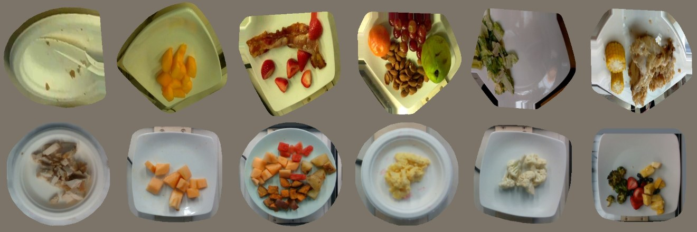
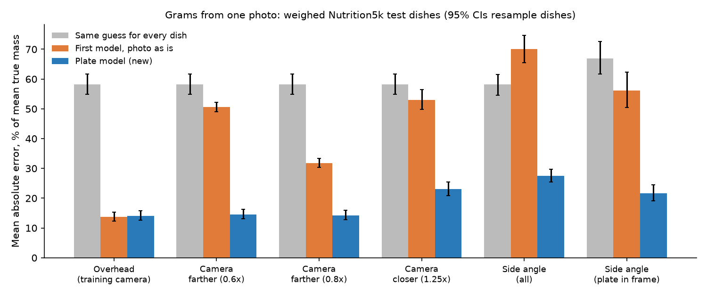
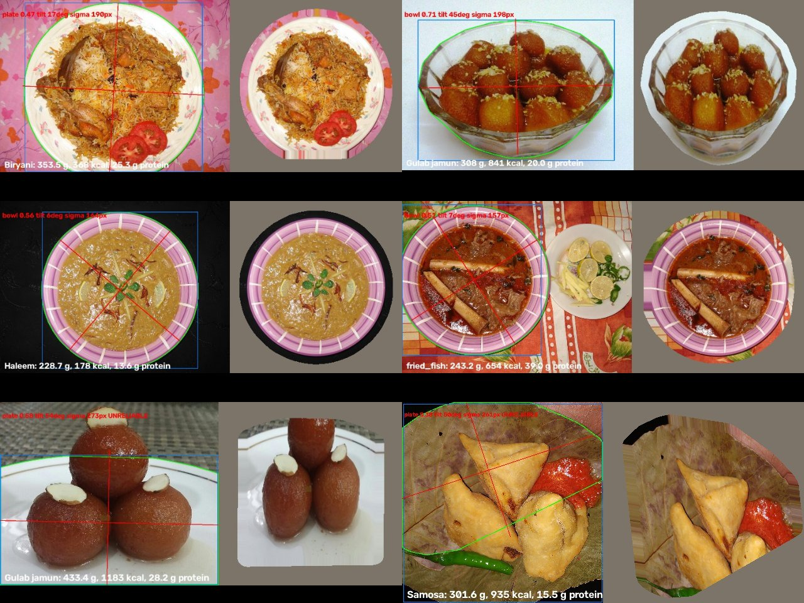

# Grams from the plate: plate detection + a plate-relative portion model

SmartBite's users photograph a meal and never type how much they ate. A photo has no scale on its own: a close-up of
three gulab jamun fills the frame like a full bowl. The first portion model (v2, `smartbite_cv/portion.py`) learned
grams from Nutrition5k's fixed overhead camera, so it only knows that one camera's scale. This step uses the
**plate as the ruler**: find the plate, undo the camera tilt, draw the plate at one fixed size, then estimate grams
from the food relative to the plate. No paid API is involved; everything runs on our own server.

Every number below comes from the Kaggle runs in this repository (`runs/plate_portion`, `reports/plate/`).

## 1. Pipeline

```
photo -> OWLv2 "plate / bowl" box -> SAM 2.1 mask -> filled outline -> shape moments (tilt + size)
      -> top-down, plate-only view (plate always 4 x 64 px across, background grey)
      -> plate-relative EfficientNet-B0 -> log grams + uncertainty -> combined with the dish's typical serving
      -> grams x nutrition table (kcal, protein, carbs, fat)
```

| Step | Code | Notes |
|---|---|---|
| Plate / bowl box | `plate.PlateDetector.find_box` | OWLv2 base [1], open-vocabulary queries "a plate", "a dinner plate", "a bowl" |
| Mask | `plate.PlateDetector.segment` | SAM 2.1 tiny [2] prompted with the box; of its 3 masks, the one whose filled outline fits the box |
| Tilt and size | `plate.mask_geometry` | A round plate seen at an angle is an ellipse, a square plate a parallelogram. Both have isotropic second moments head-on, so the moments give the tilt (short/long spread) and the size (long-axis spread, not foreshortened). Works for the rounded-square plates Nutrition5k uses, not only circles. |
| Plate-only view | `plate.plate_only_view` | Affine warp to top-down, plate drawn at a fixed size, everything off the plate grey, so no background can act as a ruler (Nutrition5k's scanning rig has fixed-size QR codes) |
| Grams | `plate_portion.PlatePortionEstimator` | ONNX model `artifacts/plate_portion`, then `fuse_with_serving` with the dish's typical serving |
| App call | `predict.FoodRecognizer(..., plate_portion_dir=...)` | Plate path first; no plate -> first portion model -> typical serving. A plate partly out of frame returns a "retake with the whole plate in view" warning |



*Plate-only views of test photos: side-angle stills (top row and first two below), overhead and zoomed-out photos.
The same dish from different cameras becomes a similar picture at a similar size.*

## 2. Data and licences

| Item | Source | Licence (quoted from the source) |
|---|---|---|
| Weighed dishes, overhead RGB + side-angle videos | Nutrition5k [3] (Google, GCS bucket; overhead via Kaggle mirror `gillesokhin/nutrition5k-dataset`, MD5-checked against the bucket in the v2 run) | "We release all Nutrition5k data under the Creative Commons V4.0 license. You are free to share and adapt this data for any purpose, even commercially." |
| OWLv2 `google/owlv2-base-patch16-ensemble` | Hugging Face model card | "apache-2.0" |
| SAM 2.1 `facebook/sam2.1-hiera-tiny` | SAM 2 README | "The SAM 2 model checkpoints, SAM 2 demo code (front-end and back-end), and SAM 2 training code are licensed under Apache 2.0" |

Side-angle stills: Nutrition5k filmed each dish with 4 Raspberry Pi cameras (A–D) at alternating 30 and 60 degree
angles. `tools/fetch_side_frames.py` downloads only the head of each video (HTTP range request) and keeps frame 3,
**only if frame 4 also decodes** (see section 5 for why), downscaled to 960 px.

Splits: Nutrition5k's official dish lists. Overhead training uses `depth_train`, testing `depth_test` (503 dishes
with a photo and a positive mass). Side stills come from the same dishes (`depth_train` ⊂ `rgb_train`,
`depth_test` ⊂ `rgb_test`, no dish in both; checked). Validation = the same seeded 10% of training dishes as the
first portion model. The test split was scored once, after training finished.

| Views built | Train | Val | Test |
|---|---|---|---|
| Overhead, plate mostly in frame / all | 2,128 / 2,466 | 244 / 275 | 438 / 503 |
| Side stills, plate mostly in frame / all | 2,782 / 9,047 | 302 / 967 | 562 / 1,798 |
| Zoomed overhead (0.6x, 0.8x, 1.25x), test only | | | 1,509 |

A plate was found in 16,483 of 16,565 photos (99.5%). Training and validation use only views where at most 20% of the
plate's outline touches the image edge ("plate mostly in frame"); a stricter rule would drop mostly the large plates.
**Every test photo is scored**, including cut-off plates; with no plate at all, the estimate falls back to the median
training mass (179 g).

## 3. Training

Same recipe as the first portion model: ImageNet EfficientNet-B0 [4] regressing log grams with a predicted
log-variance (Gaussian negative log-likelihood [5]), AdamW, warm-up + cosine, 30 epochs, early stopping on validation
MAE. Augmentation: any rotation (a top-down plate has no "up"), flips, colour jitter, ±5% scale (plate measurement
noise). Input 320x320. Best validation MAE 31.9 g (14.9%, 546 views) at epoch 28; the curve was still flat-to-improving
at the end, with no sign of overfitting on validation ([learning curve](plate/figures/learning_curve.png)).
Uncertainty: the predicted spread is scaled by 1.74, fitted on validation only.

## 4. Results (Nutrition5k test dishes, weighed)



| Photo condition | Photos (dishes) | Plate mostly in frame | Same guess for all | First model, photo as is | First model + plate scaling | **Plate model** | Plate − first model (g, 95% CI) |
|---|---|---|---|---|---|---|---|
| Overhead, training camera | 503 (503) | 87% | 116 g (58%) | 27 g (14%) | 52 g (26%) | **28 g (14%)** | +0.8 [−1.3, +2.9] |
| Camera farther (0.6x zoom) | 503 | 100% | 116 g (58%) | 101 g (51%) | 50 g (25%) | **29 g (15%)** | −71.7 [−80.2, −63.7] |
| Camera farther (0.8x) | 503 | 100% | 116 g (58%) | 63 g (32%) | 50 g (25%) | **28 g (14%)** | −34.9 [−40.2, −29.8] |
| Camera closer (1.25x) | 503 | 28% | 116 g (58%) | 105 g (53%) | 110 g (55%) | **46 g (23%)** | −59.3 [−65.5, −53.8] |
| Side angle, all stills | 1,798 (474) | 31% | 115 g (58%) | 139 g (70%) | 146 g (73%) | **55 g (27%)** | −85.4 [−92.3, −78.6] |
| Side angle, plate mostly in frame | 562 (325) | 100% | 128 g (67%) | 107 g (56%) | 129 g (67%) | **41 g (22%)** | −65.0 [−74.1, −55.7] |

Mean absolute error in grams, and as % of the mean true mass (Nutrition5k's metric). CIs resample dishes (a dish's 4
side stills move together). "First model + plate scaling" = the overhead model fed a tilt-corrected photo scaled so
the plate matches the median training plate.

More detail for the plate model:

| Condition | Median error | Within 20% | Within 30% | Mean signed error | 68% / 95% range contains the truth |
|---|---|---|---|---|---|
| Overhead | 11.7% | 70% | 82% | +17% | 68% / 93% |
| Camera farther 0.6x | 12.2% | 70% | 83% | +16% | 68% / 94% |
| Camera closer 1.25x | 20.7% | 49% | 61% | +37% | 54% / 82% |
| Side, all | 21.4% | 48% | 62% | +43% | 60% / 87% |
| Side, plate in frame | 15.4% | 59% | 74% | +18% | — |
| Per side camera (A / B / C / D), all stills | MAE 28% / 26% / 26% / 30% | | | | |

What the numbers say:

1. **On the training camera the plate model is as good as the first model** (14% vs 14%; the difference, +0.8 g, is
   not significant). Drawing every plate at one size costs nothing here, although Nutrition5k uses plates of two
   sizes (quartiles of the measured long-axis spread on training photos: 96, 125, 127 px): the model reads the plate
   size from what is on it.
2. **It no longer breaks when the camera moves.** Farther away it keeps 14–15% (first model: 32–51%). Closer, with
   the plate usually cut off, it degrades to 23% (first model: 53%).
3. **Angled photos from a different camera: 27% overall, 22% when the plate is mostly in frame.** The first model is
   worse than a constant guess there (70% vs 58%), with or without plate scaling.
4. **It overestimates.** The mean signed error is positive everywhere, most on side views and close-ups (cut-off
   plates look bigger relative to the visible food). Mean signed % is inflated by small dishes; the median error is
   the better single number.
5. **The ranges are honest on overhead and zoomed-out photos** (68% / 93–94% coverage for 68% / 95% ranges) and too
   narrow on side views and close-ups (60% / 87%, 54% / 82%).

For context only (different data and protocol): the Nutrition5k paper reports 29.5% mass MAE from an overhead RGB
image [3], and a 2025 study found ChatGPT-5 had a 30.5% calorie error from photos alone [6].

## 5. A data bug found and fixed (run 1 -> run 2)

Run 1 took frame 8 from the first 1.6 MB of each side video. Inspecting the saved views showed smeared vertical
streaks in the lower half of many stills: when the downloaded head ends inside a frame, the decoder still returns
that frame "successfully" and fills the missing part. About 25% of stills (all those where the head ended before
frame 8) plus ~8% of frame-8 stills (2 of 25 sampled) were damaged, in training and test alike. The fix keeps a frame
only when the *next* frame also decodes, and doubles the download otherwise; 48 previously damaged stills re-fetched
this way showed no streaks. Training settings were not changed between runs.

| Plate model, test MAE | Run 1 (damaged stills) | Run 2 (fixed) |
|---|---|---|
| Overhead | 30 g (15%) | 28 g (14%) |
| Side, all | 60 g (30%) | 55 g (27%) |
| Side, plate in frame | 50 g (24%) | 41 g (22%) |

Run 1 tables: `reports/plate/run1_damaged_stills/`.

## 6. Real web photos (no weighed truth: behaviour, not accuracy)



`tools/demo_plate.py` on Wikipedia photos of Pakistani dishes (full results: `reports/plate/demo/demo.json`):

- Round plates and bowls are found and straightened (biryani, haleem, nihari, gulab jamun in a glass bowl).
- Four of eight photos get the "plate partly outside the photo" warning: the gulab jamun and kheer close-ups, biryani
  on foil and samosa on a leaf (no plate; the detector picked the foil or the leaf). Those estimates are not
  trustworthy, which is why the app must ask for a retake. The close-up of three gulab jamun gets a 448 g photo
  estimate (433 g after combining with the typical serving), an obvious overestimate.
- Run 1 and run 2 models gave 217 g and 411 g for the same plate of biryani. Two models trained on the same cafeteria
  data disagree widely on an unfamiliar plate and cuisine: **out-of-domain grams are not stable yet**.
- The classifier called the nihari "fried fish" (a recognition error, separate from grams).

**Speed:** about 5 s per photo on this laptop's CPU (OWLv2 + SAM 2.1 dominate); 1.3–1.5 photos/s per T4 GPU on
Kaggle with 960-px images.

## 7. Limitations

- **Same cafeteria, same plates.** Train and test dishes come from the same two Nutrition5k cafeterias, plates and
  rigs. The side test uses unseen dishes but the same Raspberry Pi cameras as the training side stills. Real users'
  plates, food and phones are different; expect larger errors than in section 4.
- **No Pakistani dish was weighed.** Section 6 shows behaviour only. A weighed Pakistani test set (someone with a
  kitchen scale) is the missing measurement.
- **Plate size is still learned, not known.** The model infers it from what is on the plate; an unusual plate (a
  thaal, a quarter plate, a katori) can shift grams. No plate at all falls back to a typical serving.
- **One mass per photo.** Mixed plates (rice + salan + roti) get one total; per-item splitting is step 2.
- **Zoom tests are synthetic** (crops and shrinks of the overhead photo, not a moved camera).
- **Hidden oil and ghee are invisible**, as in every photo method.
- **Slow on CPU** (about 5 s); a distilled single model is step 3.

## 8. What this means for the app

Use `FoodRecognizer("artifacts/efficientnet_b0_v2", nutrition=CsvNutritionProvider("nutrition/nutrition_v2.csv"), portion_dir="artifacts/portion", plate_portion_dir="artifacts/plate_portion")`. Show
the returned range, show the retake warning when the plate is cut off, and keep the user's confirm step. Advise users
to photograph the whole plate, from above or at an angle.

```powershell
python -m smartbite_cv.predict meal.jpg --model-dir artifacts/efficientnet_b0_v2 --plate-portion-dir artifacts/plate_portion --portion-dir artifacts/portion --nutrition-csv nutrition/nutrition_v2.csv
python tools/build_kaggle.py --user <kaggle-user> --version plate      # the Kaggle run behind these numbers
python tools/demo_plate.py photo1.jpg photo2.jpg --out reports/plate/demo
```

## References

[1] M. Minderer, A. Gritsenko, and N. Houlsby, "Scaling open-vocabulary object detection," in *Proc. NeurIPS*, 2023.

[2] N. Ravi *et al.*, "SAM 2: Segment anything in images and videos," arXiv:2408.00714, 2024.

[3] Q. Thames, A. Karpur, W. Norris, F. Xia, L. Panait, T. Weyand, and J. Sim, "Nutrition5k: Towards automatic
nutritional understanding of generic food," in *Proc. IEEE/CVF CVPR*, 2021, pp. 8903–8911.

[4] M. Tan and Q. V. Le, "EfficientNet: Rethinking model scaling for convolutional neural networks," in *Proc. ICML*,
2019, pp. 6105–6114.

[5] D. A. Nix and A. S. Weigend, "Estimating the mean and variance of the target probability distribution," in
*Proc. IEEE ICNN*, 1994, pp. 55–60.

[6] See `reports/portion_estimation_research.md` for the ChatGPT-5 photo-only calorie study and the NIH app comparison.
