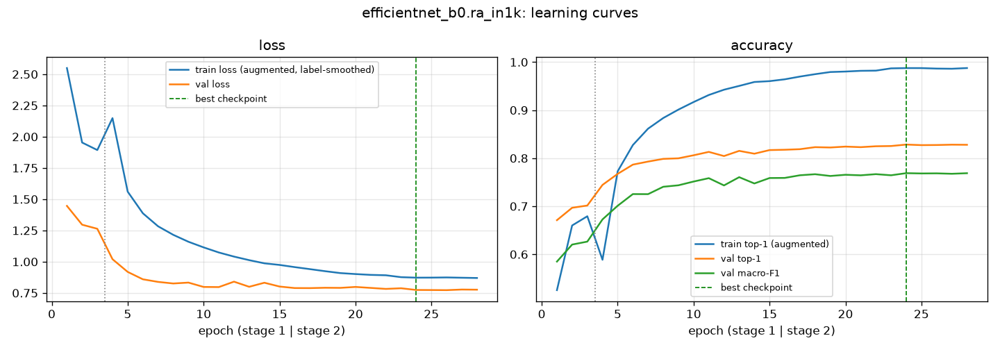
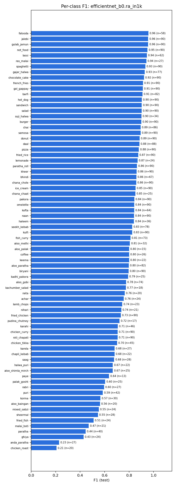
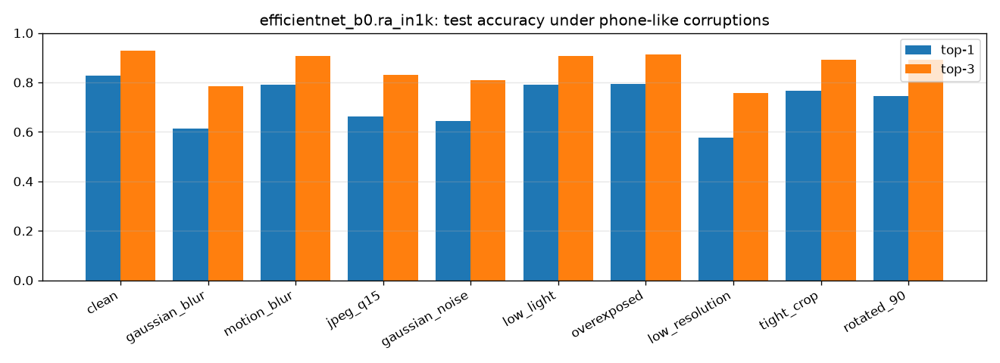
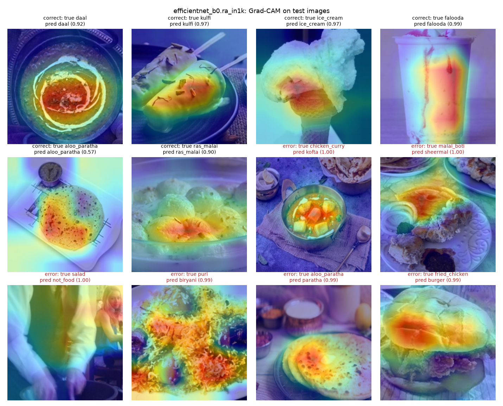

# SmartBite food recognition v2: Pakistani dishes, photo-based grams, integrity audit

1 November 2026. All numbers come from runs in this repository (Kaggle T4 GPU for training, this laptop's CPU for
the audit and the real-world test). Nothing is estimated by hand.

> Not medical advice. Calories and macronutrients are estimates from food-composition databases and a photo-based
> portion estimate. Both have large errors; the app must let the user confirm the dish and the amount.

## 1. What v2 does

Photo → **dish** (76-class EfficientNet-B0) → **grams** (portion model, combined with the dish's typical serving)
→ **kcal, protein, carbs, fat** (per-100 g values from USDA FNDDS, UK CoFID or INDB × grams).
Nothing is logged automatically: the result is a suggestion for the confirm screen (`autoLogged: false`).

```
python -m smartbite_cv.predict meal.jpg --no-plate   # dish classifier + fixed-camera portion model (models/)
```

## 2. Data

| Source | Use | Licence / terms (verbatim where published) |
|---|---|---|
| v1 sources (Food-101, 3 Indian datasets, Pakistani Dishes, Food-20, Fast Food, Food-5K) | as in v1 | see `reports/phase1_report.md` |
| **SmartFoodAnalyzer (SMF)**, `alishba7800/smf-dataset`, Farooq et al., *Nutrients* 2026 | 61 Pakistani dishes | Kaggle metadata: `unknown`. The paper says the data is "publicly available on Kaggle". Used for academic work only. |
| **Khana** (Prabhu, 2025) | 30 dish folders mapped to SmartBite classes, ≤400 images each | "Khana does not own the copyright of the images. Khana only compiles an accurate list of web images for each food dish. It is available for researchers and educators who wish to use the images for non-commercial research and/or educational purposes only." |
| **Nutrition5k** (Thames et al., CVPR 2021) | portion model | "We release all Nutrition5k data under the Creative Commons V4.0 license." (variant not named) |
| Wikipedia article photos | real-world test only | per file: CC BY-SA 2.0–4.0, CC BY 2.0/3.0, CC0, public domain (recorded in `data/external/wikipedia/wikipedia_manifest.csv`) |

**Leakage controls.**
- **SMF's augmented copies.** SMF ships augmented copies next to its originals under several naming schemes (`000005_aug1_cfc6.jpg`, `aug_0_1023.jpg`, `aug_blur_nihari_113.jpg`). Copies of one photo are grouped before splitting, so they can never land in different splits (2,504 links). Heavily altered files (noise, rotation with black corners) are train-only. Validation and test use untouched photos first; 53 val/test photos in 5 dishes are mildly altered (`aug_0_`/`aug_blur_`) because those dishes had too few untouched photos.
- **Junk removal.** 81 SMF files were excluded after visual review, each with a reason in `data/splits/exclude_v2.csv`: portraits, raw ingredients, "Puri" the city, illustrations and similar.
- **Deduplication.** Exact and near duplicates were removed by pHash, and re-crops by ImageNet-embedding cosine ≥ 0.85, before splitting. 225 clusters whose copies carried different labels were dropped.
- **Kaggle check.** All 28,556 files were MD5-verified on Kaggle before training.

| Stage | Images |
|---|---|
| collected (10 datasets) | 66,521 |
| readable, ≥ 96 px | 65,890 |
| after pHash dedupe | 58,863 |
| after embedding dedupe | 55,292 |
| **manifest** (cap 600/class, 70/15/15 split) | **28,556**: 20,001 train / 4,265 val / 4,290 test |

**Classes.**
- 76 in the model: 75 foods plus `not_food`.
- **Dropped** for fewer than 80 unique photos after deduplication: kunna (78), sattu (50), milk soda (28), aloo gosht (22). They keep nutrition rows for manual search.
- **Merged:** only near-identical meat variants (chicken/mutton/beef karahi; chicken/mutton/beef korma).

## 3. Training

Same recipe as v1:
- ImageNet weights.
- Stage 1: head only, 3 epochs.
- Stage 2: full fine-tune, up to 25 epochs, AdamW, cosine schedule, early stop after 6 epochs without val macro-F1 improvement.
- Label smoothing 0.1, sqrt class-balanced sampler, RandomResizedCrop / flip / rotation / colour jitter / random erasing.
- Temperature scaling and confidence bands chosen on validation only.

| Model | Training time | Stopped | Best epoch |
|---|---|---|---|
| EfficientNet-B0 | 42.8 min | after 25 stage-2 epochs | 21 |
| MobileNetV2 | 35.7 min | early-stopped after 21 | 15 |



## 4. Results

### 4.1 Internal test set (4,290 held-out photos, used once)

| Model | Top-1 (95% CI) | Top-3 | Macro-F1 | ECE before → after T | High band: share / correct |
|---|---|---|---|---|---|
| **EfficientNet-B0** | **82.6%** (81.5–83.7) | **92.9%** | **0.769** | 0.083 → 0.015 | 67.5% / 95.8% |
| MobileNetV2 | 79.9% (78.7–81.1) | 91.7% | 0.744 | 0.100 → 0.013 | 64.3% / 94.4% |

- EfficientNet-B0 is better by **+2.7 points** (paired bootstrap 95% CI +1.7 to +3.7; exact McNemar p = 1.6 × 10⁻⁷).
- Test matches validation (82.6% vs 82.8%), so checkpoint selection did not flatter the test number.

**Per dish** (EfficientNet F1):
- **Weakest:** chicken roast 0.21, anda paratha 0.23, ghiya 0.43, paratha 0.44, malai boti 0.47, fried fish 0.51, sheermal 0.55, mixed sabzi 0.55.
- **Strongest:** falooda 0.96, jalebi 0.96, gulab jamun 0.96, not_food 0.95, lassi 0.94, ras malai 0.94.
- **Most confused pairs:** paratha ↔ aloo paratha, palak gosht ↔ saag, naan ↔ roti, chicken curry ↔ fish curry.

The weakest classes are the SMF folders noted as label-noisy during review (chicken roast, fish, sheermal) and look-alike breads.



### 4.2 Real-world test (Wikipedia article photos, never trained on)

- **Collection:** 745 photos from 7 Wikipedia language editions.
- **Removed as duplicates of training images:** 33 (26 in train, 5 in val, 2 in test). Web datasets do contain Wikipedia photos.
- **Rejected in a photo-by-photo visual review:** 398 of the remaining 712 (wrong dish, raw ingredients, plants, scenes, packaging, multi-dish plates, unverifiable variants).
- **Scored:** 313 photos across 57 model classes. Labels were checked by the developer (AI-assisted), not by a dietitian.

| Model | Top-1 (95% CI) | Top-3 (95% CI) | ECE | High band: share / correct |
|---|---|---|---|---|
| **EfficientNet-B0** | **56.9%** (51.4–62.6) | **74.4%** (69.3–79.2) | 0.131 | 39.6% / 85.5% |
| MobileNetV2 | 55.6% (50.2–61.0) | 71.2% (66.1–76.4) | 0.123 | 39.9% / 81.6% |

**This is the most important number in the report.** Accuracy on photos from a different source is about 26 points
lower than on the internal test set. International dishes reach 68.7% top-1 and South Asian dishes 51.4%.

- **Distinctive dishes transfer well:** gulab jamun 90%, jalebi 89%, pakora 88%, pizza 82%, burger 90%.
- **Gravies do not:** korma, karahi, kadhi 0/3–0/1, nihari 1/4, chicken curry 1/4, fried fish 2/10.

Per-dish counts are small (1–14 photos), so per-dish real-world figures are indicative only.

## 5. Integrity audit (overfitting, leakage, shortcuts, robustness)

`python -m smartbite_cv.audit --run runs/efficientnet_b0_v2 --compare runs/mobilenetv2_v2`
→ `reports/integrity/efficientnet_b0_v2/integrity.json`.

| Check | Finding |
|---|---|
| Reproduction | The checkpoint re-run on CPU gives the Kaggle test logits (max diff 1.8 × 10⁻⁵, 100% same predictions). |
| **Overfitting** | Train accuracy without augmentation **100%** vs test 82.6% (17-point gap): the model memorises its training photos. Val loss did not rise after its minimum (+0.004 by the last epoch) and test = val, so the memorisation did not degrade held-out accuracy; early stopping and checkpoint selection kept it in check. |
| **Leakage** (test vs train similarity, independent MobileNetV2 embedding not used for dedupe) | Visual check of the 12 closest test↔train pairs: **11 are re-cropped or re-watermarked copies of one photo** that the 0.85 dedupe missed. Re-scoring with them removed barely moves the result: drop 19 test photos (similarity ≥ 0.88) → 82.6%; drop 72 (≥ 0.85) → 82.5%; drop 343 (≥ 0.80, mostly not copies) → **82.2%**. Test photos with no similar training photo (< 0.6) still score 77–79%. Leakage is real but inflates top-1 by under half a point. |
| **Shortcuts** | Of 2,500 Food-5K *food* photos (never trained on), only 0.9% are called `not_food`, so `not_food` did not learn "Food-5K style". Grad-CAM attends to the food on correct predictions; several confident "errors" are wrong dataset labels (a "salad" photo of people, a "puri" photo of biryani). Per source, SMF test photos score 63.7% vs 88–93% for other sources. 38 classes come from a single source dataset (mostly SMF-only Pakistani dishes), so dish and source style cannot be separated for them. |
| **Robustness** (test set, top-1) | clean 82.6; motion blur 79.0; low light 79.0; overexposed 79.4; tight crop 76.5; rotated 90° 74.5; JPEG q15 66.3; Gaussian noise 64.4; Gaussian blur 61.3; **low resolution 57.7**. High-band precision stays 86–95%. |
| **Unseen dishes** (66 Indian dishes not in the model) | 27.5% would be pre-selected (high band) as the wrong dish vs 67.5% for known dishes; most are look-alike sweets (ledikeni → gulab jamun, imarti → jalebi, sohan papdi → barfi). The confirm screen and manual search are required. |




## 6. Portion (grams) model

- **Model:** EfficientNet-B0 regressing log-grams plus its own uncertainty, trained on Nutrition5k overhead photos (official split; 2,466 train / 275 val / 503 test plates).
- **Mirror check:** 100 random test photos from the Kaggle mirror were MD5-checked against Google's bucket, and none differ.
- **Training:** 40 epochs, best at epoch 37.

| Method (503 test plates) | Mean abs. error | % of mean | Median error | Within ±20% | Within ±30% | Mean bias |
|---|---|---|---|---|---|---|
| always predict the train mean | 122.1 g | 61.5% | 53.9% | 19% | 29% | +198% |
| **SmartBite portion model** | **27.3 g** | **13.7%** | **11.8%** | **71%** | **85%** | +14.5% |
| model combined with a generic serving (train geometric mean)¹ | 29.5 g | 14.8% | 12.4% | 69% | 81% | +31.8% |
| Nutrition5k paper, overhead image only (Table 4) | 38.1 g | — | — | — | — | — |

¹ Nutrition5k has no dish-specific servings, so the app's per-dish typical serving cannot be tested here.

- **Error in nutrients:** with the true nutrients per gram, the portion error alone gives calories ±16.5%, protein ±13.7%, carbs ±17.0% and fat ±17.8%.
- **Uncertainty is slightly over-confident:** the 68% range covers 62.6% of test plates, the 95% range 89.7%.

**Limit, shown by the demo.**
- **The training setup is narrow:** Nutrition5k photos are taken 35.9 cm above a standard plate.
- **Close-up photos are badly overestimated:** on Wikipedia close-ups (photo distance unknown) the model estimated 466 g for a bowl of gulab jamun and 473 g for a plate of chicken tikka, about 2–3× plausible amounts.
- **Absolute scale can't be recovered:** without a known camera distance or a reference object, one photo doesn't give absolute size. The grams estimate is only valid for photos taken like the training data (overhead, about a forearm's length away, whole plate in view), and even then it is unverified for Pakistani food.

## 7. Nutrition table (`nutrition/nutrition_v2.csv`)

- **Coverage:** 79 foods, every value from a database row (USDA FNDDS 2021–2023, UK CoFID 2021, INDB) or from a database-defined composite (halwa puri = 2 puris + suji halwa + chanay; anda paratha = paratha + 1 egg), with serving grams from database portions.
- **60 rows are approximate:** stand-ins (nihari, karahi, paye, chapli kebab, kadhi, sheermal, falooda…), or a second database disagreeing by more than 30%.
- **Rows never used:** INDB recipes for deep-fried items with implausible values (e.g. Poori 738 kcal and 77.6 g fat per 100 g).
- **Test:** every row passes an Atwater consistency check (4P + 4C + 9F within 25% of kcal).

## 8. What this means for the app

1. Recognition is useful as a **suggestion**: the correct dish is in the top 3 for 74% of real-world photos and 93% of in-distribution photos. The confirm screen must stay.
2. **The automatic gram estimate is not yet trustworthy** for arbitrary phone photos. Until it is calibrated, default to the dish's typical serving with a small/regular/large choice. The NIH test of commercial apps found 250–345 kcal per meal undercounting when users don't adjust portions.
3. **Next data step, the single most valuable one:** 30–50 meals photographed by the team's phones and weighed on a kitchen scale. That allows (a) measuring real-world gram error, (b) calibrating the portion model's scale for phone photos, and (c) a real Pakistani recognition test.
4. **Photo guidance in the UI:** overhead, about a forearm's length away, whole plate in view, good light. Low resolution and blur cost 20–25 points of accuracy (Section 5).

## 9. Limitations

- **Web data, not phone photos:** training and internal test data come from web datasets, and the real-world test is Wikipedia photos. Phone photos may differ again.
- **SMF quality:** SMF has label noise and an unspecified licence, and 38 classes depend on a single source.
- **Unverified Pakistani nutrition:** nutrient values for Pakistani dishes are mostly stand-ins; restaurant ghee/oil can change fat by large amounts.
- **One dish per photo:** mixed plates (rice + curry + salad) get one label.
- **Small external test:** the real-world set is 313 photos, with 1–14 per dish.

## References

[1] Q. Thames, A. Karpur, W. Norris, F. Xia, L. Panait, T. Weyand, and J. Sim, "Nutrition5k: Towards automatic
nutritional understanding of generic food," in *Proc. IEEE/CVF CVPR*, 2021, pp. 8903–8911.

[2] A. U. Farooq *et al.*, "Developing a machine learning–based system for nutrient profiling of Pakistani cuisine,"
*Nutrients*, vol. 18, no. 19, p. 3173, 2026. doi:10.3390/nu18193173

[3] O. Prabhu, "Khana: A comprehensive Indian cuisine dataset," arXiv:2509.06006, 2025.

[4] B. Barz and J. Denzler, "Do we train on test data? Purging CIFAR of near-duplicates," *J. Imaging*, vol. 6,
no. 6, p. 41, 2020.

[5] S. Kapoor and A. Narayanan, "Leakage and the reproducibility crisis in machine-learning-based science," *Patterns*,
vol. 4, no. 9, 2023.

[6] R. Geirhos *et al.*, "Shortcut learning in deep neural networks," *Nat. Mach. Intell.*, vol. 2, pp. 665–673, 2020.

[7] D. Hendrycks and T. Dietterich, "Benchmarking neural network robustness to common corruptions and perturbations,"
in *Proc. ICLR*, 2019.

[8] C. G. Northcutt, A. Athalye, and J. Mueller, "Pervasive label errors in test sets destabilize machine learning
benchmarks," in *Proc. NeurIPS Datasets and Benchmarks Track*, 2021.

[9] R. R. Selvaraju *et al.*, "Grad-CAM: Visual explanations from deep networks via gradient-based localization,"
in *Proc. IEEE ICCV*, 2017, pp. 618–626.

[10] T. G. Dietterich, "Approximate statistical tests for comparing supervised classification learning algorithms,"
*Neural Comput.*, vol. 10, no. 7, pp. 1895–1923, 1998.

[11] B. Recht, R. Roelofs, L. Schmidt, and V. Shankar, "Do ImageNet classifiers generalize to ImageNet?" in *Proc.
ICML*, 2019, pp. 5389–5400.

[12] C. Guo, G. Pleiss, Y. Sun, and K. Q. Weinberger, "On calibration of modern neural networks," in *Proc. ICML*, 2017.

Competitor apps and app-accuracy studies: see `reports/portion_estimation_research.md`.
